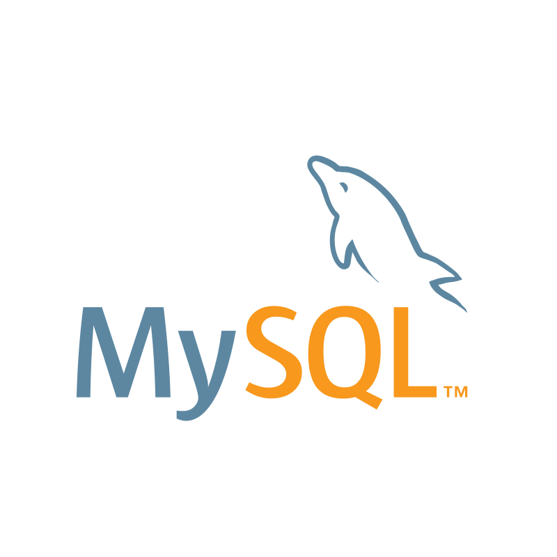
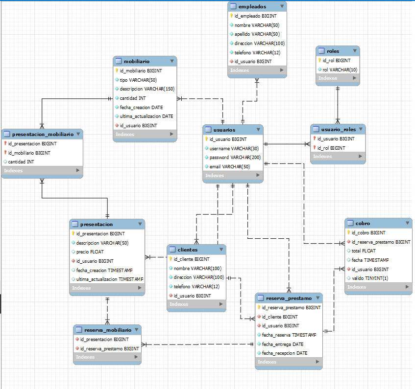

<h1 align="center">Control de Mobiliario · Backend</h1>

<div align="center"></div>

<p align="center">
  
  
  
  
</p>

## Descripción

- API REST para el personal encargado de la renta y el préstamo de mobiliario para eventos.
- El proyecto se divide en dos partes, backend y frontend. Este repositorio contiene el **backend**.
- El frontend (React) está en: https://github.com/arcan16/ControlMobiliarioFrontend

## Tecnologías utilizadas

<div align="center">



</div>

- **Java 17** y **Spring Boot 3.2.2** (Web, Data JPA, Validation, Mail)
- **Spring Security** con **JJWT 0.12.3** para la autenticación con JSON Web Tokens
- **MySQL 8** como base de datos
- **Flyway** para crear y versionar las tablas automáticamente
- **Lombok** para reducir código repetitivo
- **Maven** (incluye Maven Wrapper, no hace falta instalarlo)

## Funciones

- Autenticación y autorización con tokens JWT y roles (`ADMIN` y `USER`)
- Alta, consulta, edición y eliminación de:
  - Usuarios
  - Empleados
  - Clientes
  - Reservaciones
  - Cobros
  - Mobiliario
  - Presentaciones de mobiliario
  - Tipos de mobiliario
- Validación de la disponibilidad de mobiliario para una fecha según los préstamos agendados
- Recuperación de contraseña: se envía al correo registrado un enlace con un código que autoriza el cambio
- Envío de correos, con o sin archivos adjuntos

## Requisitos

- [Java 17](https://adoptium.net/) o superior
- [MySQL 8](https://dev.mysql.com/downloads/)
- Opcional: una cuenta de Gmail con [contraseña de aplicación](https://support.google.com/accounts/answer/185833) para enviar los correos de recuperación

## Cómo ejecutar el proyecto en desarrollo

1. Clona el repositorio:
   ```bash
   git clone https://github.com/arcan16/ControlMobiliarioBackend.git
   cd ControlMobiliarioBackend
   ```
2. Crea la base de datos en MySQL. Flyway crea las tablas al arrancar la aplicación.
   ```sql
   CREATE DATABASE mobiliario_eventos;
   ```
3. Configura las variables de entorno (ver la siguiente sección).
4. Arranca la aplicación:
   ```bash
   ./mvnw spring-boot:run        # Linux / macOS
   mvnw.cmd spring-boot:run      # Windows
   ```
   También puedes abrir el proyecto en IntelliJ IDEA o Eclipse y ejecutar la clase principal.
5. La API queda disponible en `http://localhost:8080`.

### Configuración

Las credenciales no se guardan en el código: se leen de variables de entorno.

1. Copia `.env.example` como `.env` en la raíz del proyecto. El archivo `.env` está en `.gitignore` y nunca debe subirse al repositorio.
2. Llena los valores:

| Variable | Obligatoria | Descripción |
|---|---|---|
| `DB_URL` | No | URL JDBC de la base de datos. Por defecto `jdbc:mysql://localhost:3306/mobiliario_eventos` |
| `DB_USERNAME` | Sí | Usuario de MySQL |
| `DB_PASSWORD` | Sí | Contraseña de MySQL |
| `JWT_SECRET_KEY` | Sí | Clave para firmar los tokens, en Base64 y de al menos 256 bits. Genera una con `openssl rand -base64 32` |
| `JWT_EXPIRATION` | No | Duración del token en milisegundos. Por defecto `86400000` (24 horas) |
| `ADMIN_USERNAME` | No | Usuario administrador inicial. Por defecto `admin` |
| `ADMIN_PASSWORD` | Sí | Contraseña del administrador inicial |
| `EMAIL_SENDER` | No | Cuenta de Gmail que envía los correos. Necesaria para la recuperación de contraseña |
| `EMAIL_PASSWORD` | No | Contraseña de aplicación de esa cuenta |

También puedes definir estas variables en el sistema o en la configuración de ejecución de tu IDE.

### Usuario inicial

En la primera ejecución se crea un usuario administrador con el nombre de `ADMIN_USERNAME` y la contraseña de `ADMIN_PASSWORD`.

### Scripts SQL de apoyo

- `Insertando_datos_de_prueba.sql`: datos de ejemplo para pruebas locales. No lo uses en producción, porque crea usuarios con contraseñas débiles.
- `Reset_tablas.sql`: elimina las tablas y el historial de Flyway para empezar de cero.

## Estructura del proyecto

```
src/main/java/com/example/
├── component/      # Inicialización del proyecto (crea el administrador en la primera ejecución)
├── controller/     # Controladores con los endpoints de la API
├── dto/            # Objetos que entran y salen de la API, con su validación
├── infra/
│   ├── config/     # Configuración del envío de correos
│   ├── errors/     # Manejo centralizado de errores
│   └── security/   # Seguridad: JWT, filtros, CORS y configuración de Spring Security
├── models/         # Entidades que representan las tablas de la base de datos
├── respositories/  # Repositorios JPA
└── service/        # Lógica de negocio
src/main/resources/
├── application.properties
└── db/migration/   # Migraciones de Flyway (V1, V2, ...)
```

## Diagrama de la base de datos



El archivo original, creado con MySQL Workbench, está en `ReadmeAssets/diagrama_base_de_datos.mwb`.

## Endpoints

### Autenticación

Para obtener un token:

```http
POST http://localhost:8080/login
Content-Type: application/json

{ "username": "admin", "password": "tu-contraseña" }
```

La respuesta incluye `token`. Envíalo en el resto de las peticiones con el encabezado `Authorization: Bearer <token>`. Las rutas de `/recover` son públicas; todas las demás requieren token.

En las tablas, *Rol* indica qué rol exige el endpoint; donde no se indica, basta con estar autenticado.

### `/clients`

| Método | Ruta | Rol | Descripción |
|---|---|---|---|
| POST | `/clients` | ADMIN, USER | Crea un cliente |
| POST | `/clients/name` | | Busca un cliente por nombre |
| GET | `/clients` | ADMIN, USER | Lista todos los clientes |
| GET | `/clients/{id}` | ADMIN, USER | Consulta un cliente por id |
| PUT | `/clients` | ADMIN, USER | Actualiza los datos de un cliente |
| DELETE | `/clients/{id}` | ADMIN, USER | Elimina un cliente |
| DELETE | `/clients/all/{id}` | ADMIN, USER | Elimina el cliente y sus reservaciones, siempre que no estén entregadas ni vigentes |
| DELETE | `/clients/active/{id}` | ADMIN, USER | Activa o desactiva el cliente para agendar reservaciones |

### `/cobros`

| Método | Ruta | Rol | Descripción |
|---|---|---|---|
| POST | `/cobros` | | Registra el cobro de una reservación |
| POST | `/cobros/fecha` | | Consulta los cobros de una fecha |
| GET | `/cobros` | | Lista todos los cobros |
| GET | `/cobros/total/{idReservacion}` | | Detalle completo de una reservación y su total |
| GET | `/cobros/valid` | | Lista los cobros válidos |
| GET | `/cobros/canceled` | | Lista los cobros cancelados |
| GET | `/cobros/total` | | Total cobrado en un día |
| GET | `/cobros/periodo` | | Total cobrado en un periodo |
| PUT | `/cobros` | ADMIN | Actualiza el total de un cobro |
| DELETE | `/cobros/cancel/{idCobro}` | | Cancela un cobro |
| DELETE | `/cobros/{id}` | | Elimina un cobro |

### `/employees`

| Método | Ruta | Rol | Descripción |
|---|---|---|---|
| POST | `/employees` | | Crea un empleado |
| GET | `/employees` | | Lista todos los empleados |
| GET | `/employees/{id}` | ADMIN | Consulta un empleado por id |
| GET | `/employees/myData/{username}` | ADMIN, USER | Datos de empleado del usuario que hace la petición |
| PUT | `/employees` | ADMIN | Actualiza un empleado |
| DELETE | `/employees/{id}` | ADMIN | Elimina un empleado |

### `/mobiliario`

| Método | Ruta | Rol | Descripción |
|---|---|---|---|
| POST | `/mobiliario` | | Crea un registro de mobiliario |
| GET | `/mobiliario` | | Lista todo el mobiliario |
| GET | `/mobiliario/{id}` | | Consulta un registro por id |
| PUT | `/mobiliario` | | Actualiza un registro |
| DELETE | `/mobiliario/{id}` | | Elimina un registro |

### `/presentation`

| Método | Ruta | Rol | Descripción |
|---|---|---|---|
| POST | `/presentation` | | Crea una presentación |
| GET | `/presentation` | | Lista todas las presentaciones |
| GET | `/presentation/{id}` | | Consulta una presentación con el mobiliario que incluye |
| PUT | `/presentation` | | Actualiza una presentación |
| PUT | `/presentation/all` | | Actualiza la presentación y su mobiliario |
| DELETE | `/presentation/{id}` | | Elimina una presentación y su mobiliario asociado |
| DELETE | `/presentation` | | Quita un mobiliario de una presentación |

### `/recover` (público)

| Método | Ruta | Descripción |
|---|---|---|
| GET | `/recover/{data}` | Valida el usuario o correo y envía el enlace de recuperación |
| POST | `/recover/recovery` | Valida el código recibido y actualiza la contraseña |

### `/reservacion`

| Método | Ruta | Rol | Descripción |
|---|---|---|---|
| POST | `/reservacion` | | Crea una reservación |
| POST | `/reservacion/periodo` | | Reservaciones dentro de un periodo |
| GET | `/reservacion` | | Lista todas las reservaciones |
| GET | `/reservacion/{id}` | | Consulta una reservación por id |
| GET | `/reservacion/statusOne` | | Reservaciones entregadas (estatus 1) |
| GET | `/reservacion/vigentes` | | Reservaciones sin entregar y no canceladas |
| GET | `/reservacion/entregas` | | Entregas programadas para hoy |
| GET | `/reservacion/recepcion` | | Recepciones programadas para hoy |
| PUT | `/reservacion` | | Actualiza una reservación |
| DELETE | `/reservacion` | | Elimina una reservación con los datos del cuerpo de la petición |
| DELETE | `/reservacion/{id}` | | Elimina una reservación por id |

### `/tipoMobiliario`

| Método | Ruta | Rol | Descripción |
|---|---|---|---|
| POST | `/tipoMobiliario` | | Crea un tipo de mobiliario |
| GET | `/tipoMobiliario` | | Lista todos los tipos |
| GET | `/tipoMobiliario/{id}` | | Consulta un tipo por id |
| PUT | `/tipoMobiliario` | | Actualiza un tipo |
| DELETE | `/tipoMobiliario/{id}` | | Elimina un tipo |

### `/users`

| Método | Ruta | Rol | Descripción |
|---|---|---|---|
| POST | `/users/createUser` | ADMIN | Crea un usuario |
| POST | `/users/createUserEmployee` | ADMIN | Crea un usuario junto con sus datos de empleado |
| GET | `/users/available/{username}` | ADMIN | Comprueba si un nombre de usuario está disponible |
| GET | `/users/availableue/{username}/{nombre}/{apellido}` | ADMIN | Comprueba la disponibilidad de usuario y datos de empleado |
| GET | `/users` | ADMIN | Lista todos los usuarios |
| GET | `/users/{id}` | ADMIN | Consulta un usuario por id |
| GET | `/users/actual` | | Datos del usuario que hace la petición |
| PUT | `/users` | ADMIN | Actualiza un usuario |
| PUT | `/users/update` | ADMIN | Actualiza los datos de un usuario |
| PUT | `/users/updateComplete` | ADMIN | Actualiza los datos de usuario y de empleado |
| DELETE | `/users/{id}` | ADMIN | Elimina un usuario |
| DELETE | `/users/delteUserEmployee/{id}` | ADMIN | Elimina un usuario y su empleado |

### `/v1` (correos)

| Método | Ruta | Rol | Descripción |
|---|---|---|---|
| POST | `/v1/sendMessage` | | Envía un correo |
| POST | `/v1/sendFile` | | Envía un correo con archivos adjuntos |

---

<h2 align="center">Búscame en mis redes</h2>

<p align="center">
  <a href="https://www.linkedin.com/in/sergioparedesarellano"></a>
  <a href="https://github.com/arcan16"></a>
</p>
